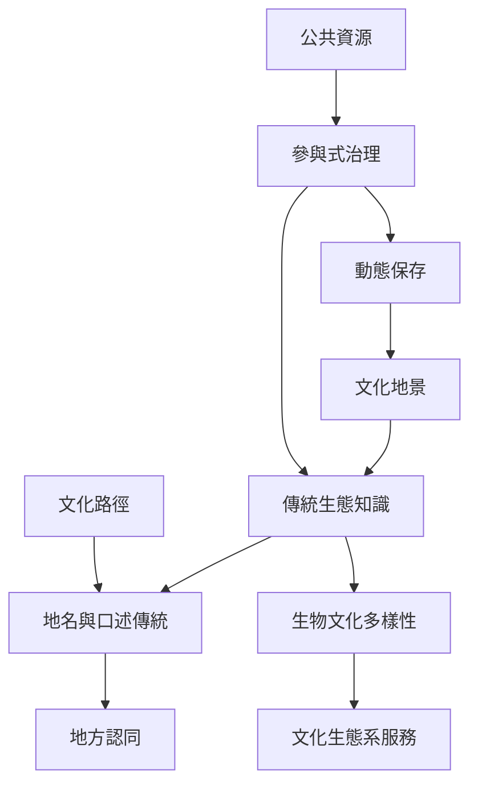

本圖聚焦活態地景如何依賴地方知識、語言、制度與生態過程。地名、路徑、口述傳統及傳統生態知識並非附屬資料，而是讓社群能辨識、使用與照護土地的知識基礎。

## 概念索引
[[文化地景]]、[[傳統生態知識]]、[[生物文化多樣性]]、[[文化生態系服務]]、[[地方認同]]、[[地名]]、[[公共資源]]、[[參與式治理]]、[[動態保存]]、[[文化路徑]]

## 關係圖

## 永久筆記
* [[自然與文化不是兩個可以任意切開的地景層]]
* [[原住民族地景知識包含責任關係而不只是資源資訊]]
* [[地方地名是一種把地景知識壓縮進語言的索引]]
* [[水利工程同時是社會制度也是文化地景骨架]]

## 文獻筆記
* [[峇里島 Subak 將水利農業儀式與社群治理整合為流域系統]]
* [[Budj Bim 證明 Gunditjmara 持續經營六千年以上的水產養殖地景]]
* [[Pimachiowin Aki 以 Anishinaabe 土地照護傳統維繫森林水域與路徑]]
* [[Pimachiowin Aki 守護者以在地知識監測生態與文化地景]]
* [[FAO GIAHS 倡議以動態保存而非凍結方式維護農業遺產]]
