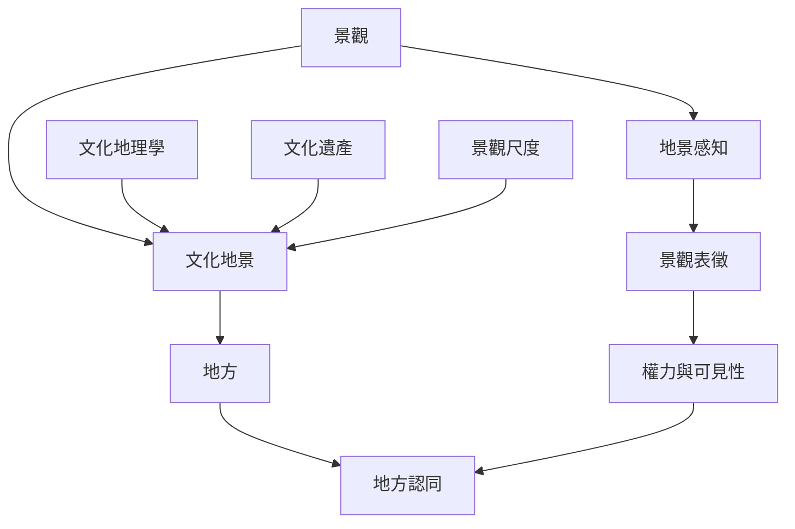

本圖從「地景是什麼」走向「地景如何被理解與治理」。文化地景同時是人地互動的結果，也是被感知、描繪、命名及管理的社會過程。文化地理學、景觀表徵與地方認同能協助辨認地景的象徵及權力面向。

## 概念索引
[[文化地景]]、[[景觀]]、[[地方]]、[[文化地理學]]、[[地景感知]]、[[文化遺產]]、[[地方認同]]、[[景觀表徵]]、[[景觀尺度]]

## 關係圖

## 永久筆記
* [[文化地景是一段持續發生的人與環境關係而不只是風景]]
* [[景觀表徵會影響誰被看見以及誰能定義地方]]
* [[居民感知是景觀政策的知識來源而不是諮詢裝飾]]
* [[UNESCO 三類文化地景是比較工具而不是普世文化分類]]

## 文獻筆記
* [[UNESCO 將文化地景界定為人與自然長期互動形成的共同作品]]
* [[Mitchell 主張景觀不只是觀看對象也是形塑身分與權力的文化實踐]]
* [[Cosgrove 將景觀視為特定社會形成的象徵表達]]
* [[Duncan 以康提王國說明閱讀景觀必須分析政治與詮釋權]]
* [[卡爾・紹爾以文化群體塑造自然地景建立文化地理學研究傳統]]
