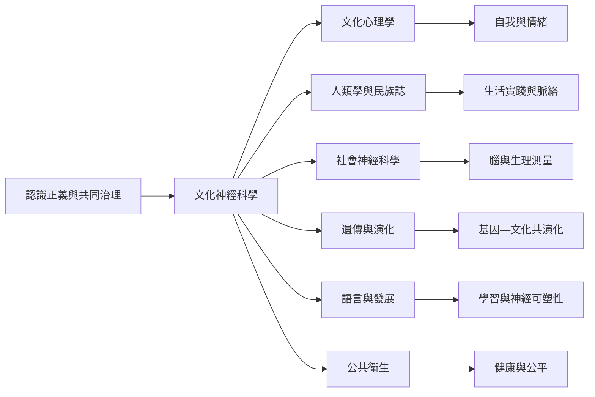

文化神經科學位於文化心理學、人類學、社會神經科學、基因與演化研究、語言研究及公共衛生的交會處。這張地圖將領域分成理論基礎、研究對象、工具方法與倫理治理。

## 參考
* [[文化神經科學以文化與生物過程的雙向作用為研究核心]]、[[文化心理學手冊把文化神經科學放進更廣泛的文化研究脈絡]]、[[跨文化情境中的神經科學研究需要把人際互動與文化脈絡一起分析]]。
* 概念：[[文化神經科學]]、[[文化心理學]]、[[社會神經科學]]、[[神經可塑性]]、[[認識正義]]。
