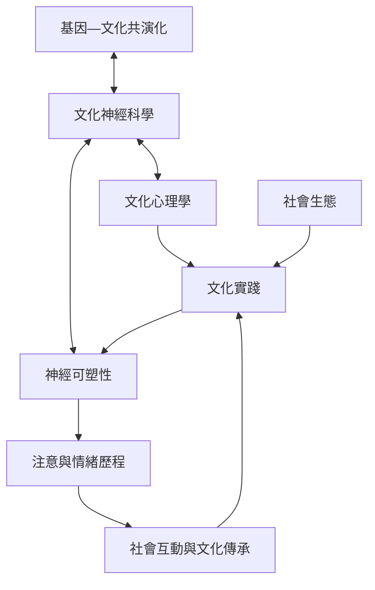

本概念地圖整理文化如何在不同時間尺度上與神經系統互相形塑。核心不是「文化決定大腦」，而是神經能力使文化學習成為可能，長期實踐又可能改變神經系統的功能組織。閱讀時可沿著理論、實踐與跨層次方法三條路徑前進。

## 參考
* [[文化不是大腦外部背景而是神經發展環境的一部分]]、[[大腦是文化傳承與更新的中介場所]]、[[文化差異應由具體實踐和脈絡解釋]]。
* 概念：[[文化神經科學]]、[[文化心理學]]、[[神經可塑性]]、[[文化—神經互塑]]、[[基因—文化共演化]]、[[社會生態]]。
