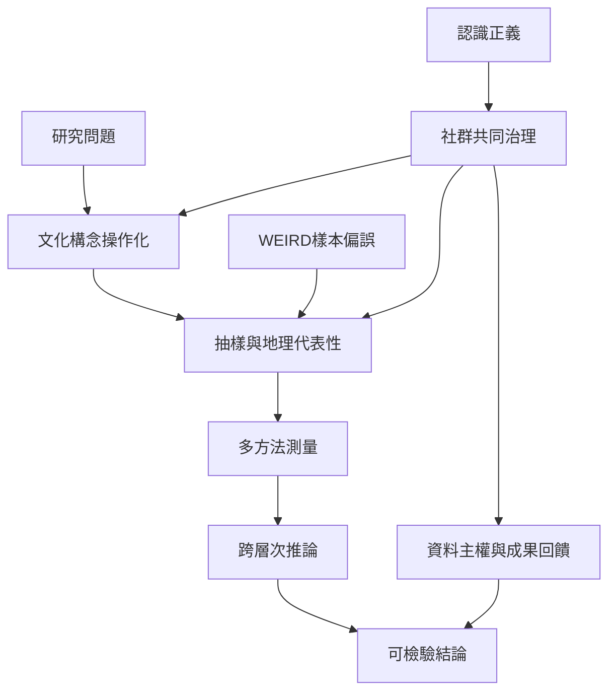

本地圖整理文化神經科學的抽樣、測量、推論與治理問題。全球性主張必須接受樣本代表性檢查；跨文化合作則應將地方研究者與社群視為知識主體，而不只是受試者或資料提供者。

## 參考
* [[小樣本與族群代表性限制全球性推論]]、[[研究地理不平等會限制人類普遍性的主張]]、[[研究倫理應讓社群成為共創知識者]]。
* 概念：[[WEIRD樣本偏誤]]、[[認識正義]]、[[雙眼觀看]]、[[認知神經影像]]。
