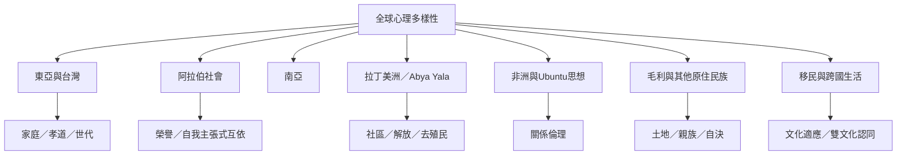

全球文化心理學必須越過單一東西方比較，納入不同生態區域、殖民歷史、族群知識、移民與文化動態。地區研究是切入點，不是對整個區域貼標籤。

概念：[[生態文化複合體]]、[[文化適應]]、[[雙文化認同]]、[[Ubuntu]]、[[Te Whare Tapa Whā]]、[[孝道雙元模型]]、[[心理多樣性]]。

永久筆記：[[親族土地與集體記憶構成原住民族心理脈絡]]、[[文化差異必須在群體內部差異中理解]]、[[移民與雙文化認同是持續的身份協商]]。

靈感筆記：[[將愛洋洋的跨域知識整理成全球文化心理學索引]]、[[用生活中的互惠與共食實踐理解文化中的關係倫理]]。

文獻：[[原住民族心理研究必須將殖民歷史與土地關係納入分析]]、[[文化認同與心理福祉會在跨文化接觸中持續協商]]、[[拉丁美洲解放與社區心理學要求心理知識回應歷史權力]]。

延伸概念：[[集體記憶]]、[[社會再生產]]、[[集體照顧]]。

新增區域案例：[[毛利健康模型將土地親族與精神視為心理福祉的構成條件]]、[[非洲中心的人觀將人格形成理解為社會文化共同塑造的歷程]]、[[AI介入關係時應評估它補充還是取代人際互惠]]、[[印度宗教哲學概念與心理學概念之間需要翻譯而非直接等同]]。
