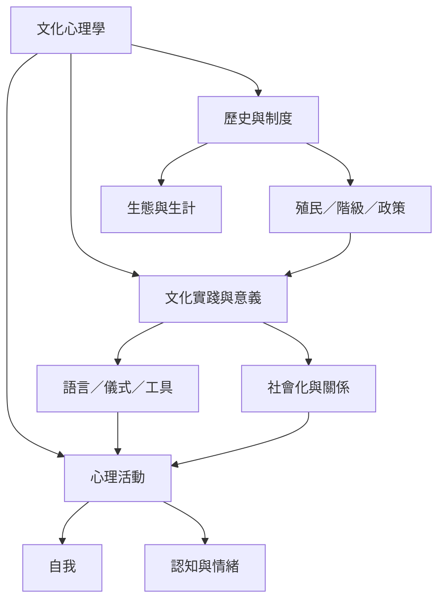

文化心理學的中心問題，是心理與文化如何在歷史、制度、語言與日常實踐中互相構成。研究不能只列舉國家差異，而應連結心理機制、生活脈絡、研究方法與權力關係。

核心概念：[[文化心理學]]、[[文化脈絡]]、[[文化動態]]、[[文化社會化]]、[[生態文化複合體]]、[[心理多樣性]]。

永久筆記：[[文化與心理在歷史實踐中互相構成]]、[[文化是動態傳遞與協商的過程]]、[[文化心理學應將日常實踐視為心理形成的場域]]。

靈感筆記：[[以文化位置與日常活動建立自己的田野觀察日誌]]、[[把文化心理學讀書會設計成共同探究而非文化分類遊戲]]。

文獻：[[文化心理學應從生態與文化區域理解超越東西方的心理多樣性]]、[[文化心理學必須研究心理與文化如何共同變動]]。
