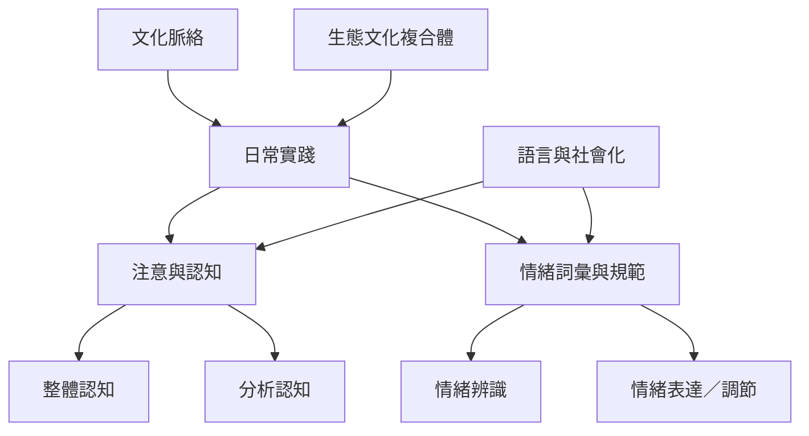

認知、情緒與動機不是文化的附屬物，也不是完全獨立於文化的普遍機制。文化實踐會讓某些注意方式、解釋模式、情緒詞彙與表達規則更常被使用。

概念：[[整體認知]]、[[分析認知]]、[[文化情緒]]、[[文化社會化]]、[[生態文化複合體]]。

永久筆記：[[認知風格受到日常實踐與生態環境形塑]]、[[文化也以情緒概念與表達規則塑造經驗]]。

靈感筆記：[[比較不同語言中的情緒詞可以揭示感受如何被命名]]、[[把禪修團體當成文化實踐而非普世心理技術來研究]]。

文獻：[[整體與分析認知差異反映注意與解釋習慣而非智力高低]]、[[情緒調節的文化差異涉及表達與內在經驗兩個層面]]。

延伸概念：[[認知風格]]、[[語言相對論]]、[[情緒調節]]、[[身體化認知]]、[[情境認知]]、[[社會文化取向]]、[[宗教認知]]。
