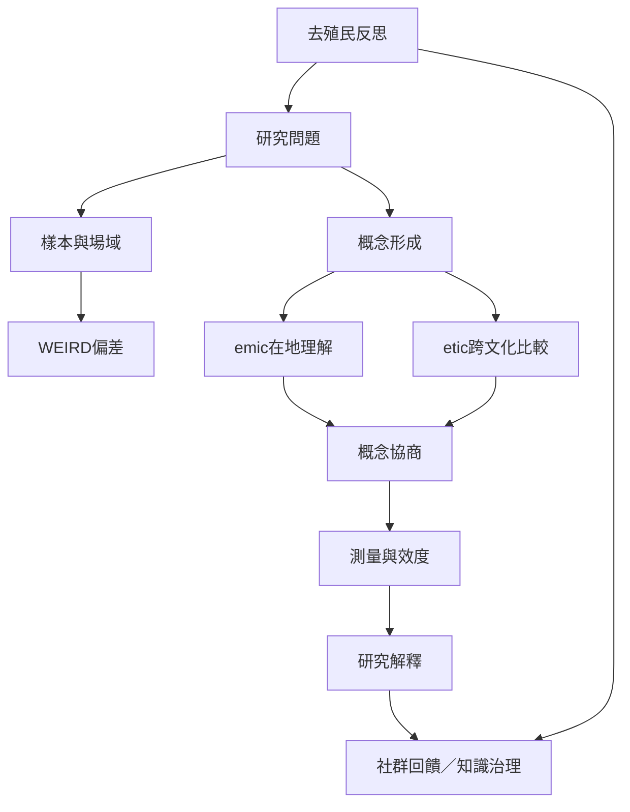

跨文化研究要同時面對樣本代表性、概念翻譯、測量效度、研究者位置與知識權力。比較的目的不是消除所有差異，而是說清楚在何種條件下可以比較，以及比較結果對誰有意義。

概念：[[跨文化心理學]]、[[emic與etic]]、[[測量等值性]]、[[WEIRD樣本]]、[[原生文化心理學]]、[[去殖民心理學]]、[[解放心理學]]、[[原住民族心理學]]。

永久筆記：[[研究比較需避免把國家平均值投射個人]]、[[研究者必須在emic與etic之間建立可反思的橋梁]]、[[去殖民心理學必須改變知識生產的權力關係]]。

靈感筆記：[[設計跨區域訪談時先問生活實踐再問抽象價值]]、[[研究傳統知識時先建立社群同意與知識治理原則]]。

文獻：[[心理學若只研究WEIRD樣本便可能把少數經驗誤認為人類普遍性]]、[[跨文化測量應兼顧本土意義與可比較性]]、[[文化測量不應把統計等值當成跨社會比較的唯一標準]]。

延伸概念：[[知識主權]]、[[知識公平]]、[[多元知識系統]]。

新增方法案例：[[南非喪偶者的訪談顯示Ubuntu支持網絡也可能帶來限制]]、[[使用AI整理跨文化訪談時保留原語與參與者的詮釋權]]。
