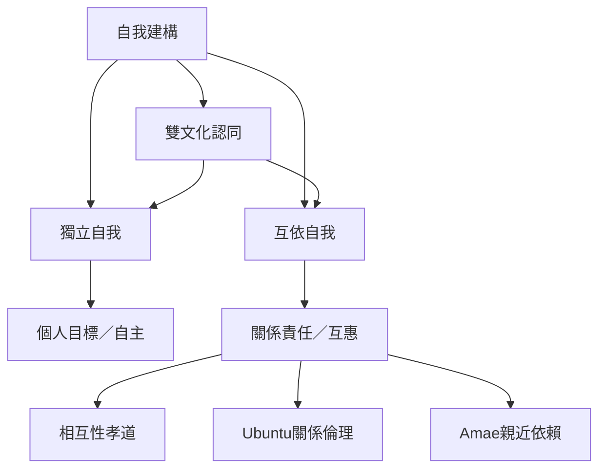

自我不是脫離關係的固定實體。文化心理學研究人們如何在具體關係、角色與制度中理解自主、互惠、責任和歸屬。獨立與互依是分析向度，而非互斥的人格類型。

概念：[[自我建構]]、[[獨立自我]]、[[互依自我]]、[[個人主義]]、[[集體主義]]、[[孝道雙元模型]]、[[Ubuntu]]、[[Amae]]、[[雙文化認同]]。

永久筆記：[[自我不是脫離關係的固定實體]]、[[台灣的孝道研究應區分相互性與權威性]]。

靈感筆記：[[觀察同一個人在不同關係中如何轉換自我模式]]、[[用文化心理學重新檢視自我照顧與互相照顧的界線]]。

文獻：[[文化會形塑自我而自我也在文化實踐中延續]]、[[阿拉伯文化中的互依可以同時包含自我主張]]、[[台灣縱貫研究顯示孝道與自主互依發展的關係並非單向]]。

區域延伸：[[非洲中心的人觀提醒心理學不能預設孤立個體是唯一分析單位]]、[[印度宗教哲學概念與心理學概念之間需要翻譯而非直接等同]]。
