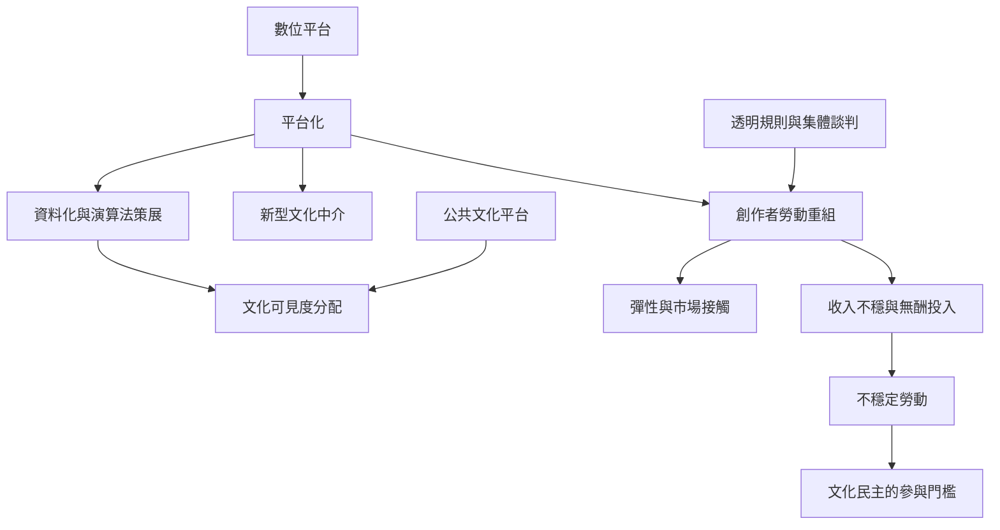

平台化改變的不只是文化內容的上網方式，也改變文化中介、可見度、資料與勞動條件。平台提供觸及受眾的機會，同時可能將創作者置於演算法排序、商業條款與不穩定收入的依賴關係中。

可先讀[[平台化使文化可見度成為需要治理的稀缺資源]]及[[創作者的自主性取決於平台規則之外的談判能力]]，再連到[[無酬創作讓文化產業把職業風險轉嫁給創作者家庭]]。概念條目包括[[平台化]]、[[平台資本主義]]、[[文化勞動]]、[[不穩定勞動]]、[[無酬勞動]]、[[文化中介者]]與[[演算法策展]]。
