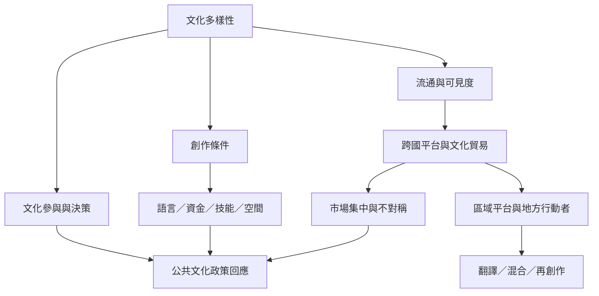

文化多樣性不是單純的內容數量，而是不同社群能否創作、使用自己的語言、進入流通網絡、被看見並參與文化決策。跨國平台與貿易網絡提供機會，也可能集中資料、收益與分配權力；地方文化行動者則持續協商、改編並創造區域流通方式。

閱讀[[文化多樣性是創作與流通條件的多樣而不只是內容數量]]，再接續[[全球文化流通是地方行動者與跨國平台持續協商的過程]]與[[文化經濟成長不等於創作者獲得公平分配]]。概念條目包括[[文化多樣性]]、[[文化民主]]、[[文化帝國主義]]、[[全球文化流通]]、[[文化政策]]與[[公共財]]。
