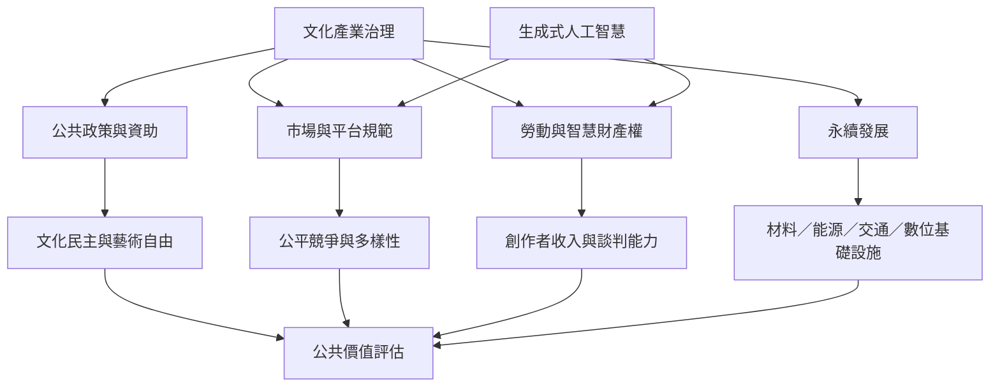

文化產業治理需要同時處理市場發展、創作自由、文化勞動、公共資源、科技變遷與生態成本。國家既能提供長期基礎設施，也可能介入表達；AI 與數位平台擴大創作工具，也重分配權利、資料與收益。政策成效不宜只看產業總額。

可從[[國家既能扶植文化生態也可能控制文化表達]]開始，搭配[[生成式人工智慧把文化產業的焦點推向資料權利與收益分配]]及[[文化產業的統計邊界會影響政策如何看見文化工作]]。概念條目包括[[文化政策]]、[[藝術自由]]、[[智慧財產權]]、[[生成式人工智慧]]、[[文化勞動]]與[[公共財]]。
