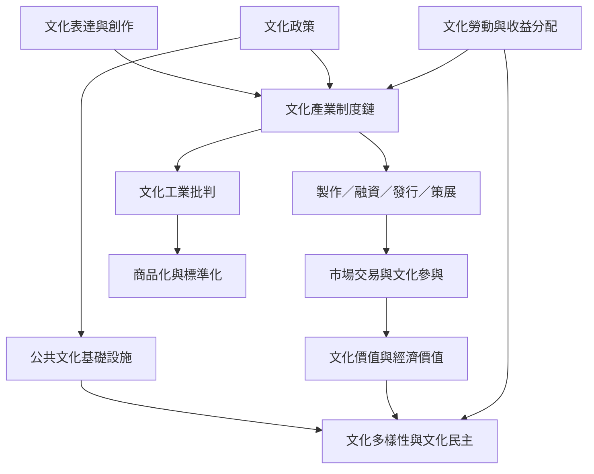

文化產業可同時從文化價值、商品形式、制度鏈與公共政策理解。文化工業批判提醒商品化可能造成標準化；文化產業與創意經濟研究則檢視創作如何進入生產、分配及國際貿易。兩者需要以文化多樣性、文化民主與勞動權益作為規範性檢驗。

延伸閱讀可由[[文化工業與文化產業是兩種不同層次的分析語彙]]開始，再讀[[文化產業的核心張力是文化價值與商品價值不可互相化約]]、[[文化產業不是單一部門而是一條創作生產分配與參與的制度鏈]]及[[文化經濟成長不等於創作者獲得公平分配]]。相關概念包括[[文化工業]]、[[文化產業]]、[[創意產業]]、[[創意經濟]]、[[文化政策]]、[[文化價值]]與[[公共財]]。
