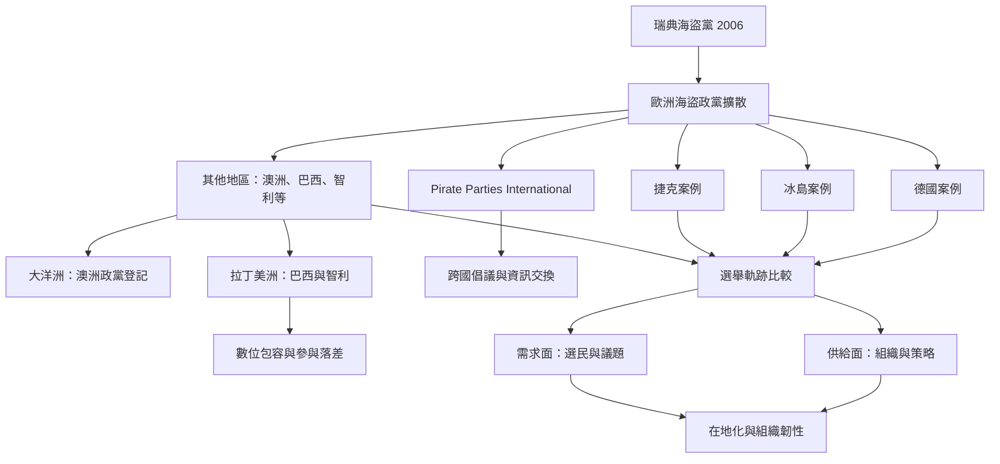

本圖描繪海盜政治由瑞典 2006 年起源、擴散到歐洲及其他地區，再透過 Pirate Parties International 建立跨國網絡的歷程。除了瑞典、德國、冰島與捷克，也納入澳洲、巴西及智利的組織和制度材料。各地政黨共享部分數位權利價值，但選舉制度、社會脈絡和組織策略造成不同軌跡。

核心筆記：[[海盜政治把數位權利轉化為民主改革議程]]、[[海盜政黨的跨國比較必須同時分析供給與需求]]、[[全球海盜政黨網絡的會員名單不能代替地方脈絡研究]]、[[澳洲巴西與智利案例顯示運動轉型受到不同制度條件塑造]]、[[海盜政黨全球研究應避免以歐洲成功個案代表整個運動]]、[[捷克海盜黨以跨層級組織降低單一選舉依賴]]。

相關文獻：[[瑞典海盜黨2009年歐洲議會突破與後續衰退]]、[[德國海盜黨LiquidFeedback研究指出委任權力不必然導致操控]]、[[冰島海盜黨的生命週期研究與2024年失去國會席次]]、[[智利海盜黨自述從駭客倫理與自由文化發展水平式政治]]、[[智利資訊科技輔助公民政治組織研究揭示數位與參與落差]]、[[巴西海盜黨從2007年運動發展為全國性創黨集會]]、[[巴西海盜黨的2009年訪談連結知識共享隱私與數位包容]]、[[澳洲選舉委員會於2013年批准Pirate Party Australia登記]]、[[Pirate Parties International把數位時代自由與人權連成跨國議程]]。

概念節點：[[海盜政黨]]、[[數位權利]]、[[自由文化]]、[[跨國倡議網絡]]、[[多層級政黨體系]]。
