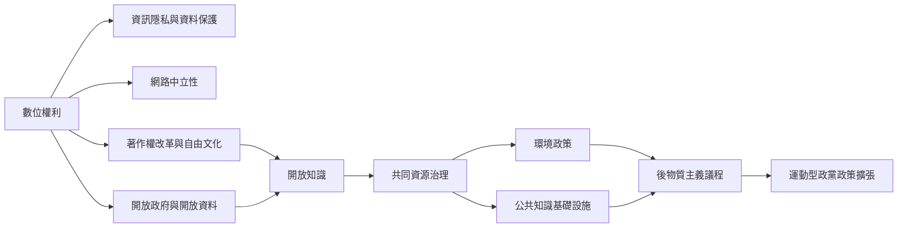

海盜政治從網路自由、隱私與著作權改革出發，逐步連結開放政府、開放資料、文化共享、環境政策和公共服務。這張圖以共同資源與民主治理作為跨議題的橋樑。

核心筆記：[[海盜政治把數位權利轉化為民主改革議程]]、[[共同資源把數位權利與環境政策連接起來]]、[[海盜黨由單一議題轉為後物質主義政黨]]、[[開放不代表免除維護與問責]]。

概念節點：[[數位權利]]、[[資訊隱私]]、[[資料保護]]、[[網路中立性]]、[[著作權改革]]、[[自由文化]]、[[開放政府]]、[[開放資料]]、[[開放知識]]、[[共同資源]]、[[後物質主義]]。
