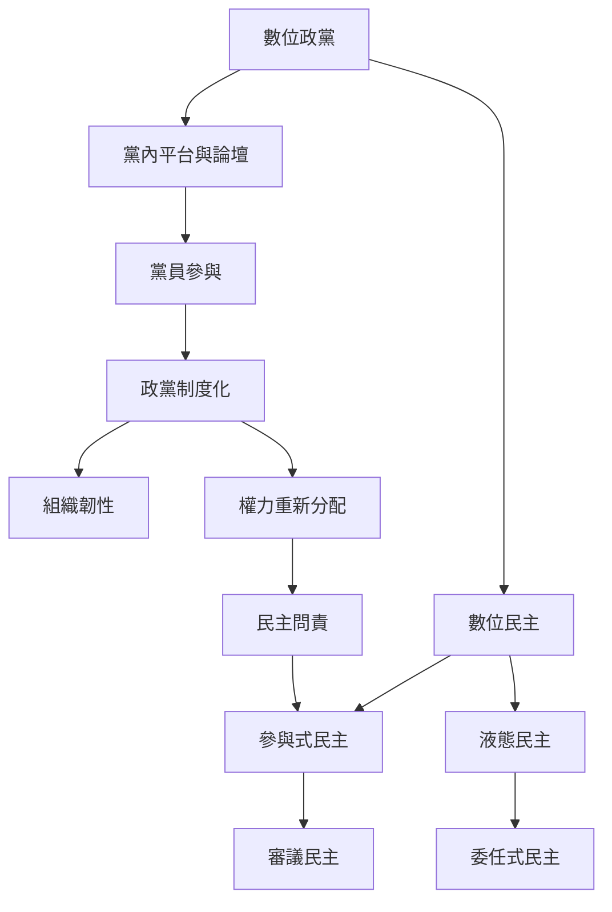

本圖以捷克海盜黨作為個案，串聯數位政黨、參與式民主、液態民主、黨內審議及制度化。線上平台能創造參與入口，但其效果受到參與者能力、議程設定權和線下組織資源調節。

核心筆記：[[捷克海盜黨的核心創新在組織而不只政策]]、[[參與式數位工具不能取代組織基礎建設]]、[[數位參與的可近性不等於實質影響力平等]]、[[液態民主的委任機制需要權力分布監測]]、[[政黨制度化增加韌性也重新分配權力]]。

概念節點：[[數位政黨]]、[[數位民主]]、[[參與式民主]]、[[審議民主]]、[[液態民主]]、[[委任式民主]]、[[政黨制度化]]、[[組織韌性]]。
