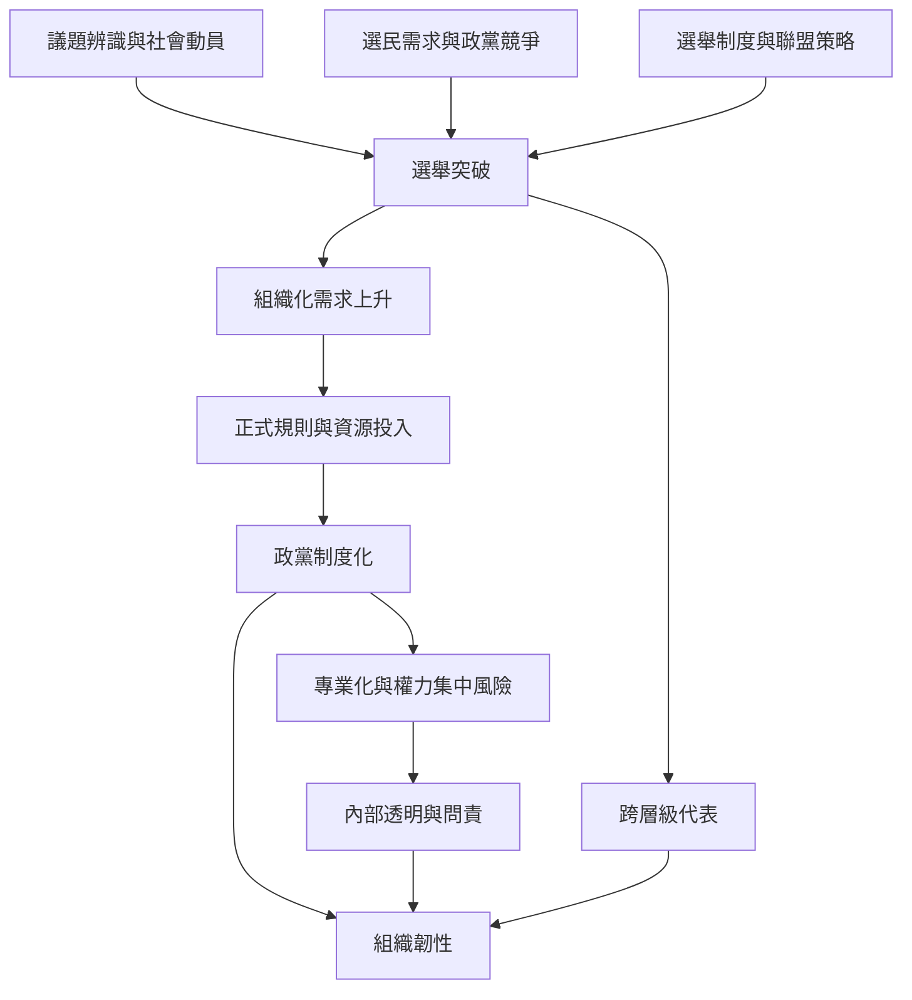

本圖將選舉突破、組織制度化、跨層級資源、政黨生命週期與組織韌性連結。選舉表現是重要但不充分的結果指標；政黨能否長期存在，還取決於會員制度、內部規則、資源與地方組織。

核心筆記：[[政黨生命週期需要從辨識走向組織與穩定化]]、[[政黨制度化增加韌性也重新分配權力]]、[[偏好投票會改變聯盟內部的席次分配]]、[[捷克海盜黨以跨層級組織降低單一選舉依賴]]。

實證來源：[[捷克海盜黨由線上草根組織轉向制度化政黨的研究]]、[[瑞典德國與捷克海盜黨的多層級選舉軌跡比較]]、[[歐洲海盜政黨二十年比較研究提出供給與需求兩側分析]]。

概念節點：[[政黨制度化]]、[[組織韌性]]、[[政黨生命週期]]、[[運動型政黨]]、[[選舉聯盟]]、[[偏好投票]]。
