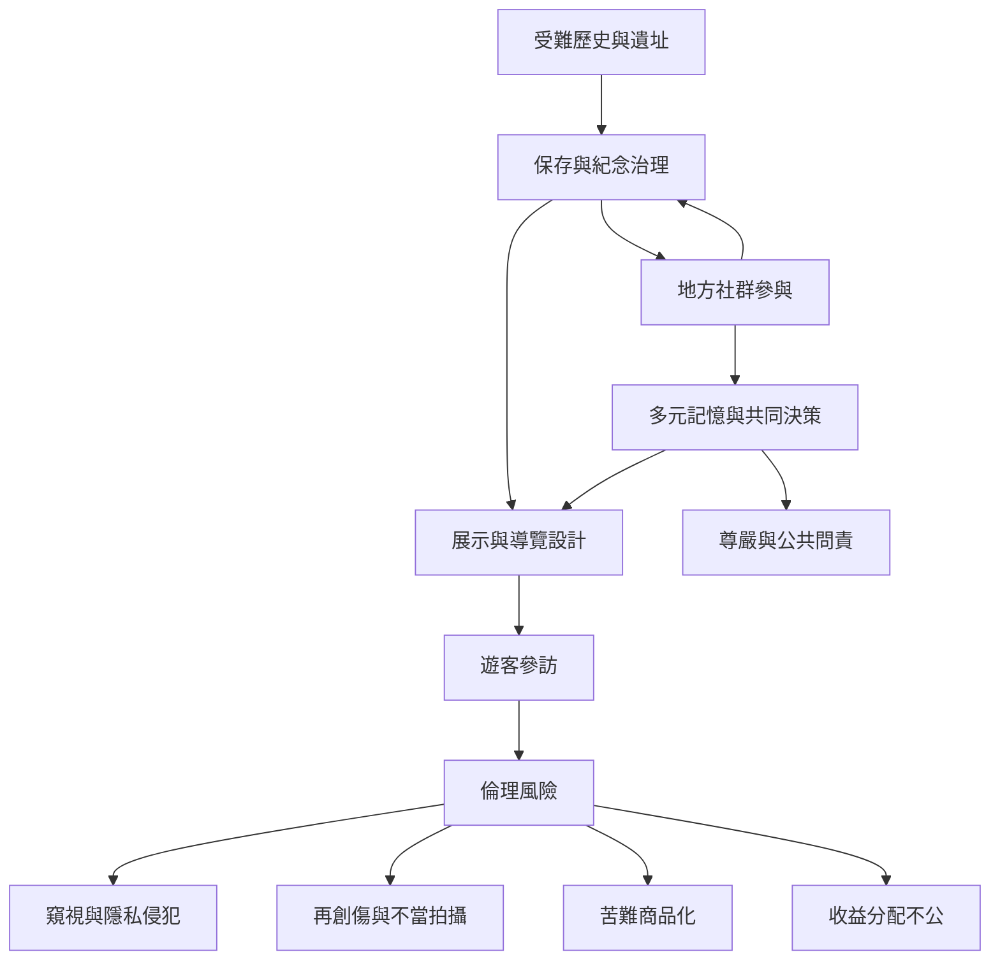

暗黑觀光的倫理風險不是只發生在遊客個人行為，也包含展示內容、商業模式、管理制度與地方社群參與。治理需要同時處理隱私、再創傷、商業收益、敘事權與公共教育。

核心概念：[[遺產商品化]]、[[地方社群記憶]]、[[轉型正義]]、[[修復性正義]]、[[遺產不協調]]。

可參照[[苦難商品化會複製原有權力敘事]]、[[紀念地的倫理必須落實為空間與行為規則]]與[[國家記憶敘事可能排除地方經驗]]。

延伸概念：[[暗黑觀光光譜]]、[[朝聖觀光]]、[[遺產治理]]。
