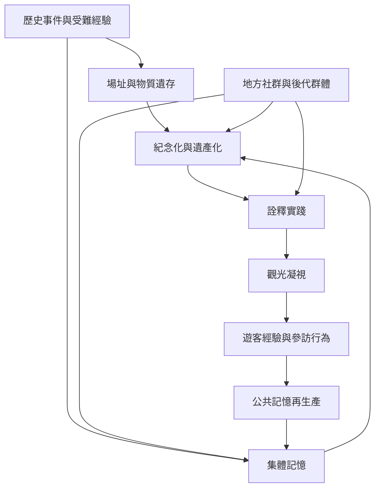

暗黑觀光由場址、歷史事件、記憶治理、展示詮釋與遊客觀看共同形成。以下關係圖將「地點」放回社會關係之中：一處場所能否成為觀光目的地，取決於誰保存、誰說故事、誰前往觀看，以及哪些聲音被排除。

核心概念：[[暗黑觀光]]、[[暗黑遺產]]、[[困難遺產]]、[[集體記憶]]、[[紀念化]]、[[觀光凝視]]、[[詮釋實踐]]、[[地方社群記憶]]。

可參照[[暗黑觀光不是場址本身的屬性而是記憶被觀看的關係]]、[[紀念化不等於記憶已被完整保存]]與[[地方社群與後代群體應參與記憶治理]]。

延伸概念：[[暗黑觀光光譜]]、[[朝聖觀光]]、[[遺產治理]]。
