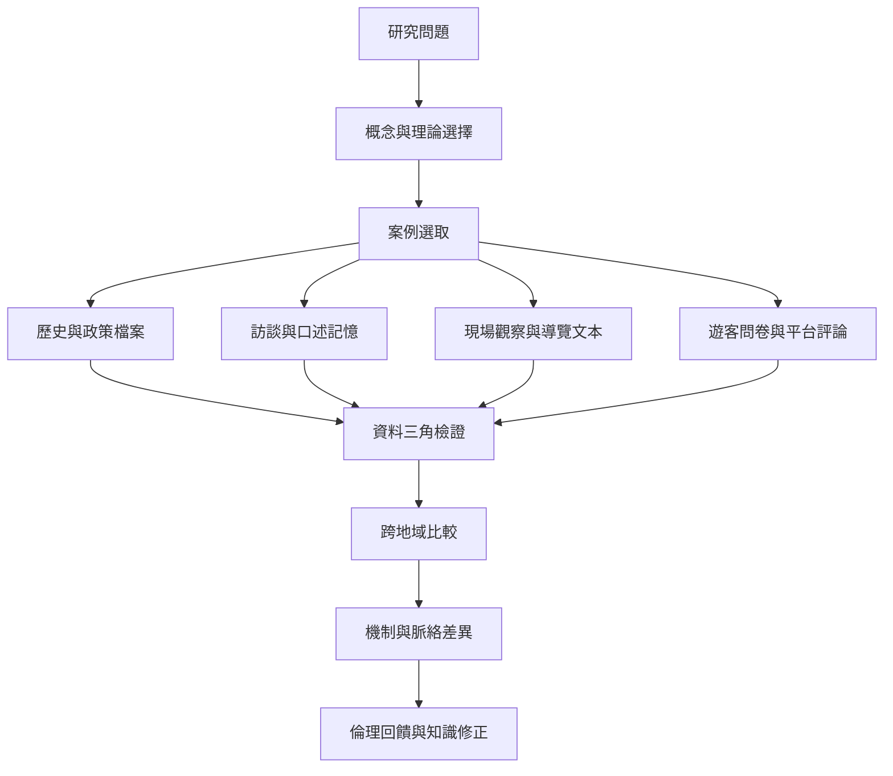

跨地域研究必須同時處理比較架構與資料來源的局限。不同案例之間不一定能用同一量尺衡量；研究者應先解釋脈絡，再比較機制與差異。

核心概念：[[詮釋實踐]]、[[暗黑觀光光譜]]（參考[[暗黑觀光光譜能比較場址但不能替代倫理判斷]]）、[[遺產不協調]]、[[地方社群記憶]]。

可參照[[研究方法三角檢證能降低單一遊客資料造成的偏差]]、[[數位評論能補充但不能取代地方聲音]]與[[以場址比較表分析不同地區的記憶政治]]。
