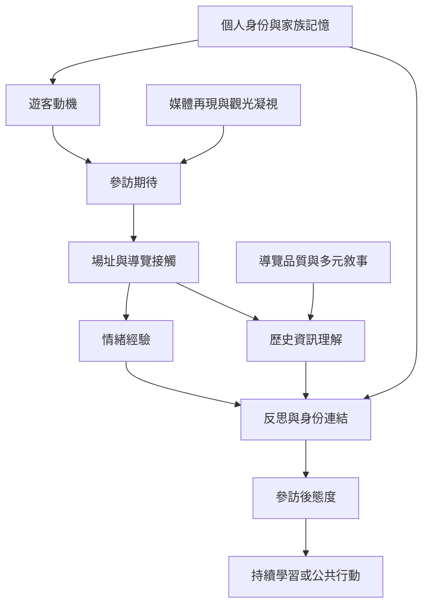

參訪動機會影響遊客注意什麼、如何理解歷史與參訪後採取何種態度，但動機、情緒、學習與行動並非自動連續的階段。研究要觀察它們之間的中介條件。

核心概念：[[遊客動機]]、[[後記憶]]、[[觀光凝視]]、[[集體記憶]]、[[戰場觀光]]、[[災難觀光]]。

可參照[[遊客動機是多元且混合的]]、[[情緒經驗不等於歷史理解]]、[[身份認同會改變同一遺址的參訪意義]]。

延伸概念：[[暗黑觀光光譜]]、[[朝聖觀光]]、[[遺產治理]]。
