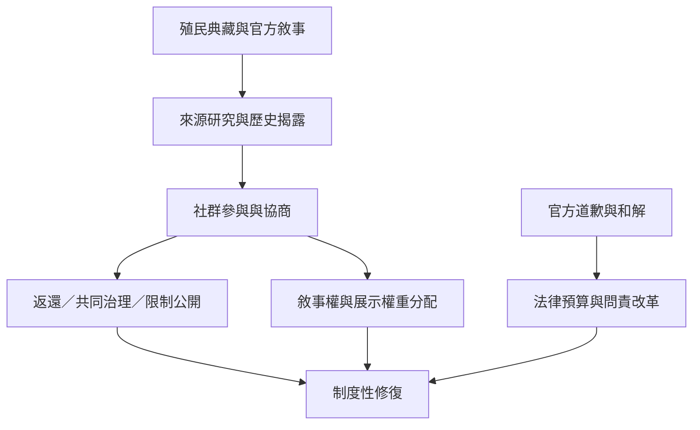

本圖將博物館返還、資料治理、官方和解與公共教育放在同一張制度圖中。制度改革必須從象徵性的代表性改變，進一步觸及所有權、決策權、資料控制與補救。

概念關聯：[[殖民遺產]]、[[原住民族資料主權]]、[[土地返還]]、[[知識正義]]、[[自由事先和知情同意]]。

## 參考
* [[博物館去殖民已從典藏爭議擴展至記憶與參與]]；[[臺灣原住民族道歉與歷史正義仍需從象徵走向制度]]；[[CARE原則將原住民族資料治理置於集體利益與自決之中]]。
