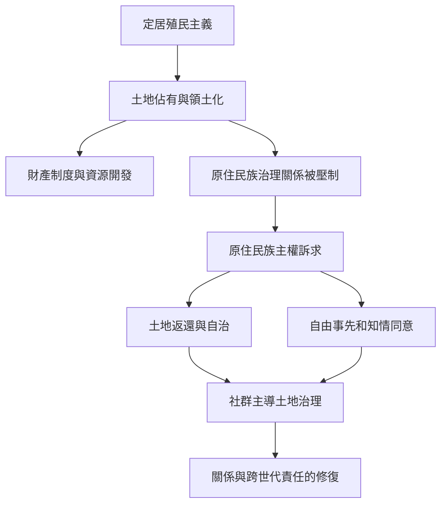

本圖呈現定居殖民主義如何將土地轉化為國家領土與私有財產，並與原住民族的土地關係和治理權產生衝突。去殖民化需要超越文化承認，處理領土、資源、同意與自治。

概念關聯：[[原住民族主權]]、[[定居殖民主義]]、[[土地返還]]、[[民族自決]]、[[自由事先和知情同意]]。

## 參考
* [[Tuck與Yang提醒去殖民不能被稀釋為社會正義隱喻]]；[[聯合國原住民族權利宣言保障土地文化與自由事先知情同意]]；[[臺灣原住民族主權在國家和解與地緣政治間持續協商]]。
