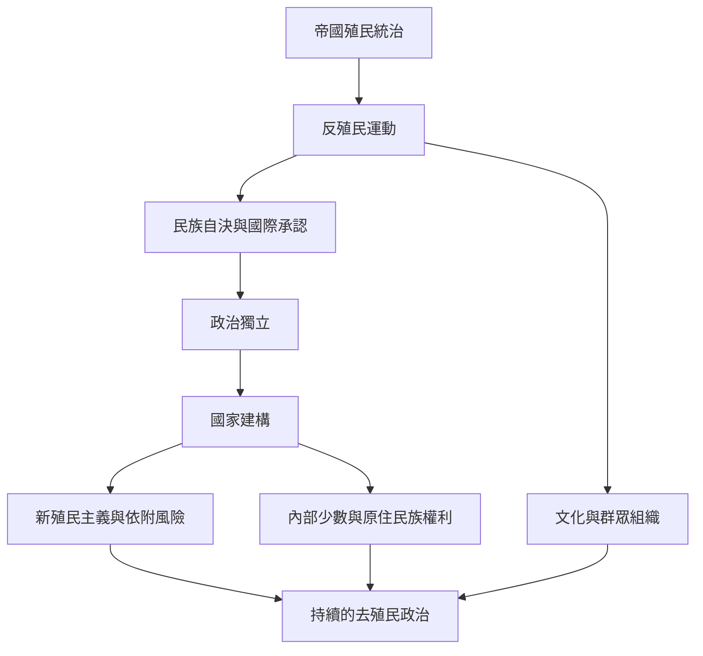

本圖聚焦從反殖民運動、國際自決規範到獨立後國家建構的歷史路徑。政治獨立並非過程終點，需進一步檢查經濟依附、國內階級及原住民族權利。

概念關聯：[[去殖民化]]、[[反殖民主義]]、[[民族自決]]、[[新殖民主義]]、[[殖民主義]]。

## 參考
* [[聯合國去殖民化宣言將民族自決確立為國際政治議程]]；[[Fanon《大地上的受苦者》將去殖民視為主體與政治秩序的重構]]；[[印尼獨立戰爭地方視角揭示革命經驗並不單一]]。
