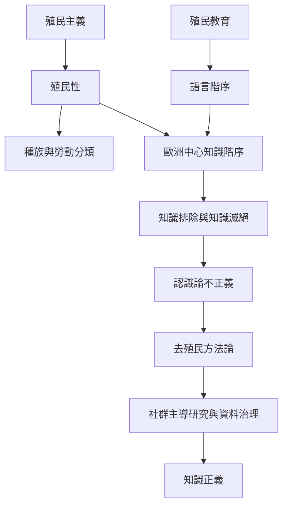

本圖整理殖民權力如何由行政統治延伸至分類、知識與日常常識。去殖民知識實踐並非簡單增加不同作者，而是改變問題設定、資料控制、詮釋權和知識流通的制度。

概念關聯：[[殖民性]]、[[權力殖民性]]、[[知識正義]]、[[知識滅絕]]、[[去殖民方法論]]、[[語言去殖民]]。

## 參考
* [[Quijano以權力殖民性解釋殖民行政結束後的制度延續]]；[[Smith主張原住民族研究必須重掌問題與知識治理]]；[[Ngũgĩ指出語言是殖民權力與文化主體性的戰場]]。
