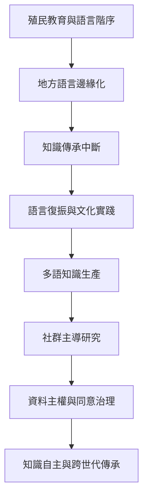

本圖將語言復振、文化實踐、教育與研究倫理視為彼此相連的知識主體性工程。重點不是拒絕外來知識，而是消除單一語言與研究體制壟斷解釋權的制度條件。

概念關聯：[[語言去殖民]]、[[去殖民方法論]]、[[原住民族資料主權]]、[[自由事先和知情同意]]、[[知識正義]]。

## 參考
* [[Ngũgĩ指出語言是殖民權力與文化主體性的戰場]]；[[Smith主張原住民族研究必須重掌問題與知識治理]]；[[CARE原則將原住民族資料治理置於集體利益與自決之中]]。
