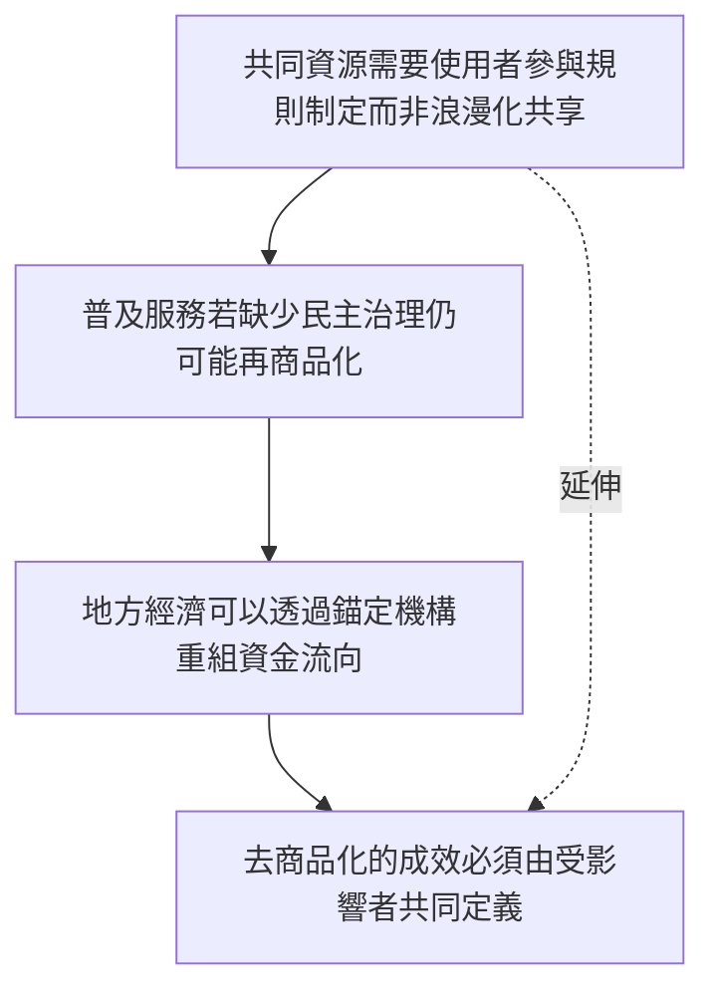

本圖將去商品化從福利給付延伸至共同資源、合作社、平台治理與地方經濟。共同管理不是自動公平，必須處理規則、責任、資料、勞動與問責。

## 關係圖

## 概念連結
* [[共同資源需要使用者參與規則制定而非浪漫化共享]]
* [[普及服務若缺少民主治理仍可能再商品化]]
* [[地方經濟可以透過錨定機構重組資金流向]]
* [[去商品化的成效必須由受影響者共同定義]]

## 延伸概念
* [[去商品化]]
* [[社會權利]]
* [[普及基本服務]]
* [[共同資源]]
