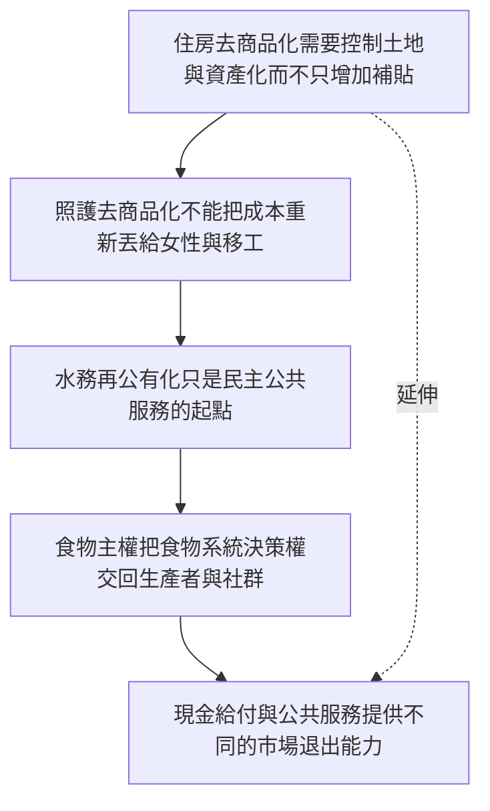

本圖把去商品化落在可感受的生活領域。各領域都必須同時檢視資源供給、服務品質、財政來源、治理權力與分配公平。

## 關係圖

## 概念連結
* [[住房去商品化需要控制土地與資產化而不只增加補貼]]
* [[照護去商品化不能把成本重新丟給女性與移工]]
* [[水務再公有化只是民主公共服務的起點]]
* [[食物主權把食物系統決策權交回生產者與社群]]
* [[現金給付與公共服務提供不同的市場退出能力]]

## 延伸概念
* [[去商品化]]
* [[社會權利]]
* [[普及基本服務]]
* [[共同資源]]
