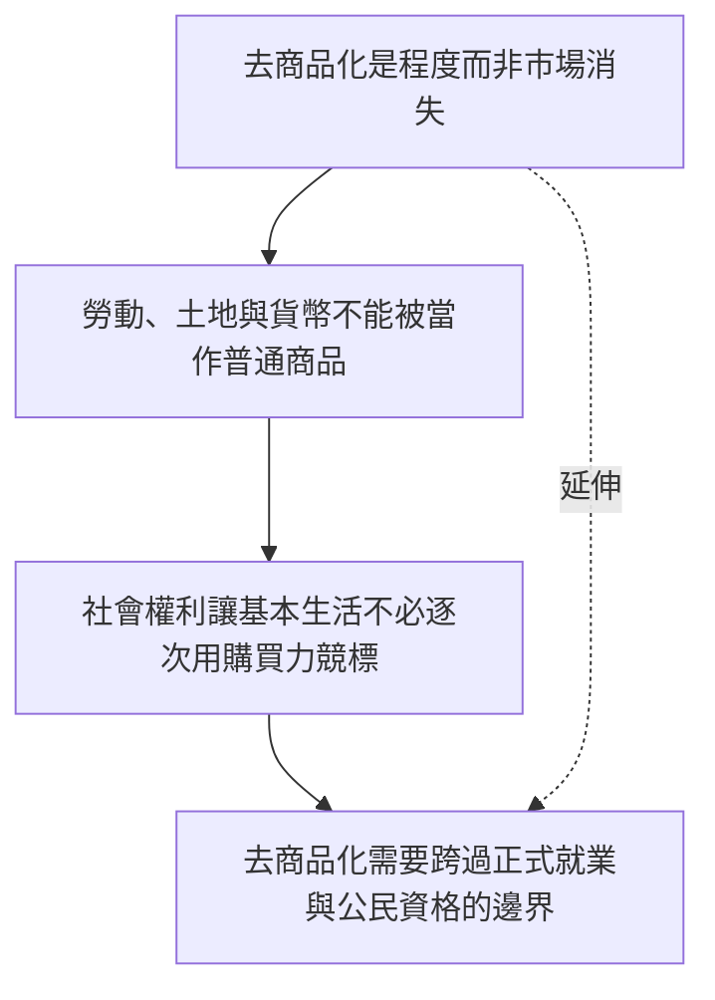

本圖整理去商品化的理論起點：波蘭尼對虛構商品的批判、Esping-Andersen 的福利國家指標，以及社會權利如何降低市場依賴。重點是市場與社會的制度關係，而不是簡單的公私二分。

## 關係圖

## 概念連結
* [[去商品化是程度而非市場消失]]
* [[勞動、土地與貨幣不能被當作普通商品]]
* [[社會權利讓基本生活不必逐次用購買力競標]]
* [[去商品化需要跨過正式就業與公民資格的邊界]]

## 延伸概念
* [[去商品化]]
* [[社會權利]]
* [[普及基本服務]]
* [[共同資源]]
