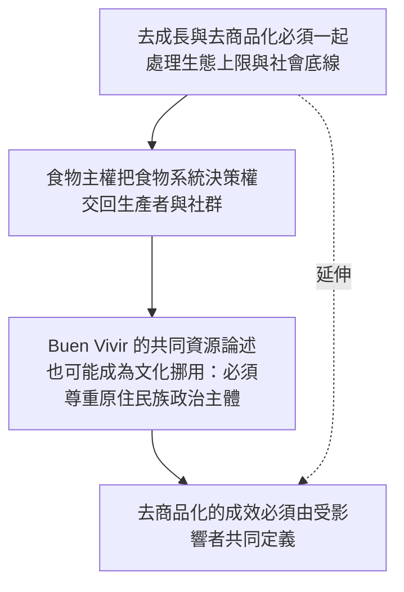

本圖把去商品化與後成長、生態福利國家及全球南方的社群政治脈絡連接。去商品化應保障社會底線、尊重生態上限，也避免挪用原住民族知識。

## 關係圖

## 概念連結
* [[去成長與去商品化必須一起處理生態上限與社會底線]]
* [[食物主權把食物系統決策權交回生產者與社群]]
* [[Buen Vivir 的共同資源論述也可能成為文化挪用：必須尊重原住民族政治主體]]
* [[去商品化的成效必須由受影響者共同定義]]

## 延伸概念
* [[去商品化]]
* [[社會權利]]
* [[普及基本服務]]
* [[共同資源]]
