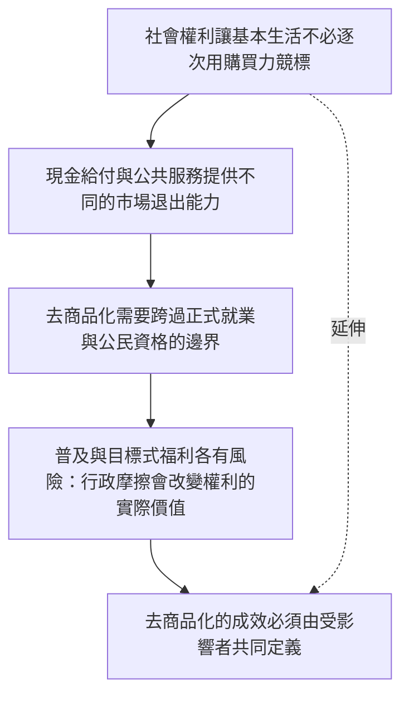

本圖由福利國家走向社會權利、普及性與行政資格設計，並納入東亞制度的產品主義路徑，以及障礙者、移工與非正式工作者的制度邊界。

## 關係圖

## 概念連結
* [[社會權利讓基本生活不必逐次用購買力競標]]
* [[現金給付與公共服務提供不同的市場退出能力]]
* [[去商品化需要跨過正式就業與公民資格的邊界]]
* [[普及與目標式福利各有風險：行政摩擦會改變權利的實際價值]]
* [[去商品化的成效必須由受影響者共同定義]]

## 延伸概念
* [[去商品化]]
* [[社會權利]]
* [[普及基本服務]]
* [[共同資源]]
