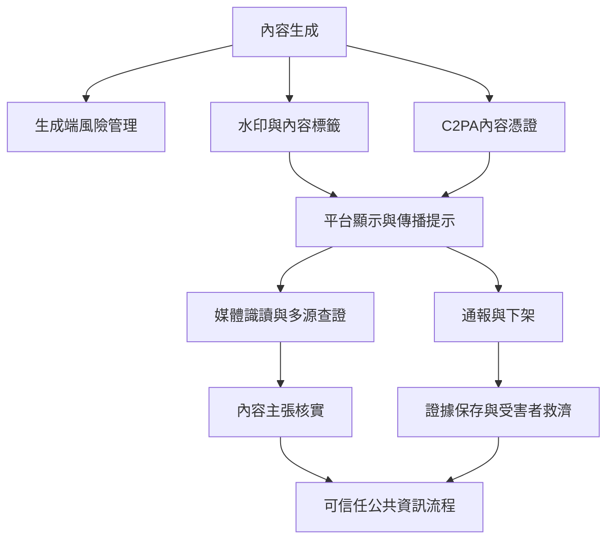

治理不應依賴單一偵測器，而要結合生成端防濫用、來源溯及、標示、平台處理、媒體識讀與法律救濟。這張地圖把技術訊號和社會流程分開呈現。

- [[term/數位來源溯及]]追蹤檔案來源與修改歷程。
- [[term/C2PA內容憑證]]與[[term/水印]]提供互補的技術標記。
- [[term/媒體識讀]]支援來源和內容主張查核。
- [[term/跨資料集泛化]]提醒偵測工具的泛化限制。

參考：[[data/合成內容治理需要來源標記偵測與防濫用多層措施]]、[[data/C2PA以可驗證來源鏈取代單純真假分類]]、[[data/歐盟AI法第50條已於2026年8月2日啟動深偽透明義務]]及[[data/中國2025年標識辦法要求顯式與隱式標識生成合成內容]]。
