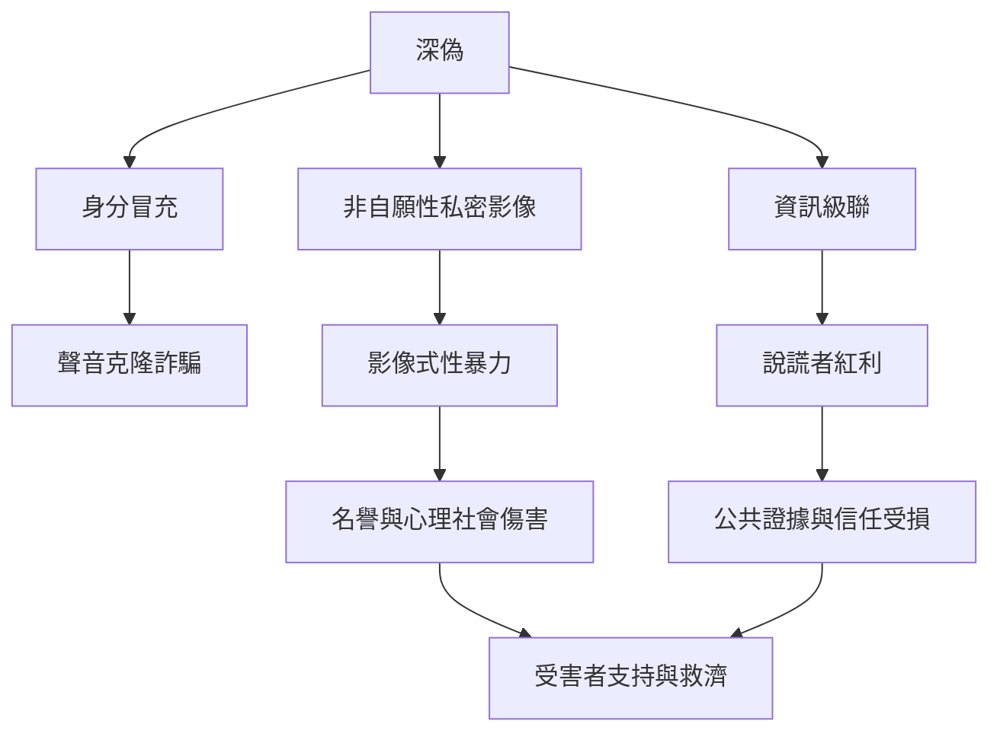

深偽的傷害不是技術單獨造成，而是人物身份、性別權力、媒介傳播、資訊級聯與社會信任共同作用的結果。地圖呈現常見傷害路徑與相關概念。

- [[term/非自願性私密影像]]與[[term/影像式性暴力]]說明合成性影像的權利侵害。
- [[term/聲音克隆]]呈現信任關係如何被冒用。
- [[term/資訊級聯]]與[[term/說謊者紅利]]說明傳播與公共信任風險。

參考：[[data/非自願性深偽的傷害包含受害者必須證明影像是假的負擔]]、[[data/聯合國將深偽色情置於性別暴力與數位安全脈絡]]、[[data/FBI指出生成式AI可放大語音克隆與視訊冒充詐騙]]。
