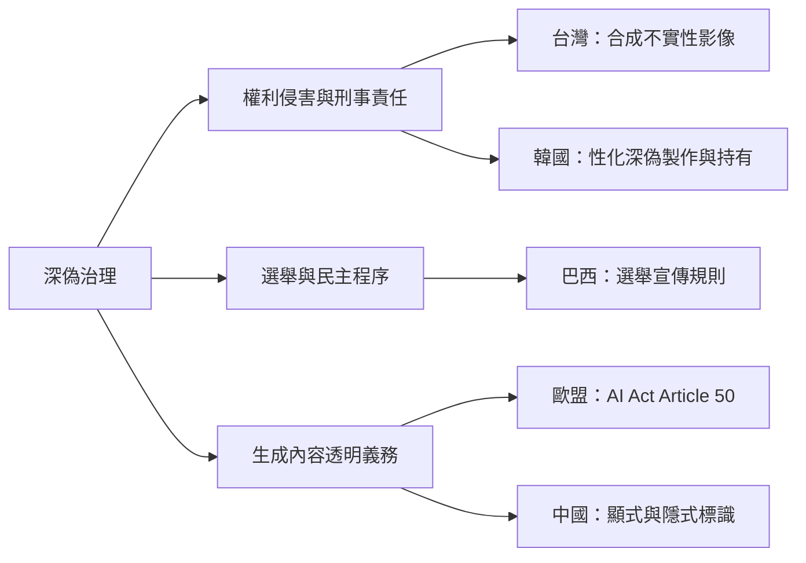

各地制度以不同方式處理深偽風險：部分規範針對性影像或犯罪行為，部分聚焦選舉完整性，部分要求廣泛生成內容標示。比較制度時，應保留法律範圍、責任主體與程序保障的差異。

- 台灣與韓國：[[data/台灣刑法第319條之4明文處理合成不實性影像]]、[[data/韓國針對深偽性影像擴張製作與持有相關刑責]]。
- 巴西：[[data/巴西將選舉合成媒體標示與Deepfake禁用納入規範]]。
- 歐盟與中國：[[data/歐盟AI法第50條已於2026年8月2日啟動深偽透明義務]]、[[data/中國2025年標識辦法要求顯式與隱式標識生成合成內容]]。

制度比較應留意修法時間；本地法律適用以官方最新文本為準。
