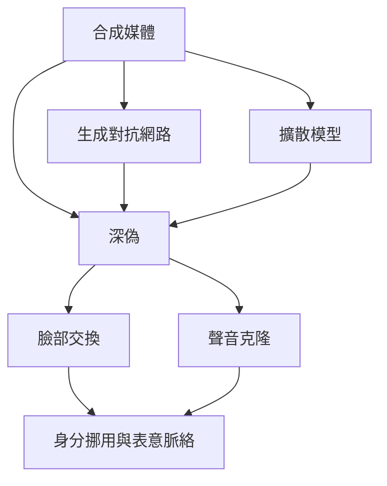

深偽由多種生成技術和媒介組合構成。以下地圖從較廣義的合成媒體出發，連到深偽的核心形式與生成技術。不同技術並非互斥，也不代表所有使用都具有欺騙意圖。

- [[term/合成媒體]]：更廣泛的生成與修改媒體類別。
- [[term/深偽]]：涉及人物身份或現實呈現操縱的合成媒體。
- [[term/臉部交換]]、[[term/聲音克隆]]：常見身份挪用形式。
- [[term/生成對抗網路]]、[[term/擴散模型]]：不同世代的生成架構。

來源與定義參考：[[data/深偽起源於人臉替換但今日已擴展為多模態合成媒體]]、[[data/深偽研究的實證證據仍集中於西方且缺少跨國比較]]。
