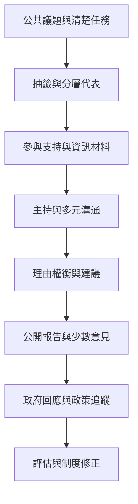

小型公民審議的制度設計不能只決定人數與會議天數，還必須回答誰進入、資訊如何提供、討論怎樣進行、結論有何權限，以及政府如何回應。此地圖將 [[抽籤式代表]]、[[公民議會]]、[[參與平等]]、[[審議品質]] 與 [[政策回應機制]] 放在同一制度鏈上。

## 關係圖

## 延伸連結
* 綜合：[[抽籤代表提高人口多樣性但不能自動創造實質平等]]、[[小型公民審議應補充而非取代廣泛公民自我治理]]。
* 案例：[[愛爾蘭公民議會把憲法爭議帶入公民審議]]、[[比利時德語區把抽籤公民審議制度化為常設對話]]。
* 概念：[[小型公民審議]]、[[公民議會]]、[[抽籤式代表]]、[[參與平等]]、[[審議品質]]。
