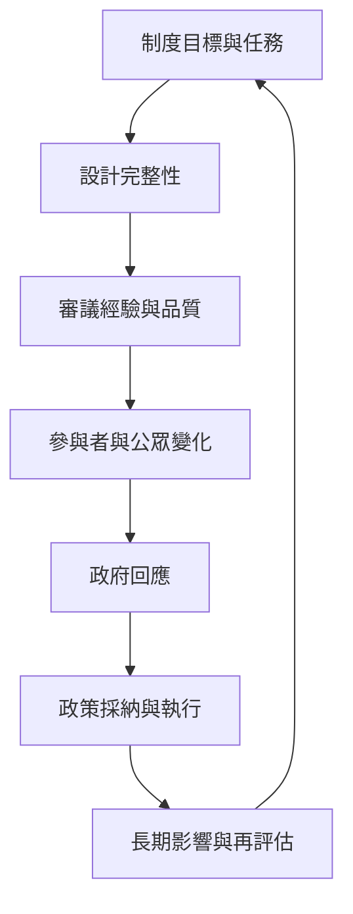

制度評估需要分辨程序是否公平、參與者是否學習、公共討論是否外溢，以及政策是否真正改變。此地圖將 [[審議品質]]、[[審議評估]] 與 [[政策回應機制]] 串接，並以氣候公民議會的政策影響作為案例提醒。

## 關係圖

## 延伸連結
* 綜合：[[審議品質與政策影響必須使用不同評估指標]]、[[政策回應是讓公民審議產生民主效力的關鍵環節]]。
* 研究：[[代表性審議程序應分別評估設計經驗與政策影響]]、[[審議品質的測量方式仍存在理論與方法上的差異]]。
* 案例：[[英國氣候公民議會展示公民能權衡減碳政策取捨]]、[[氣候公民議會的政策影響取決於政治授權與後續壓力]]。
* 概念：[[審議品質]]、[[審議評估]]、[[政策回應機制]]。
