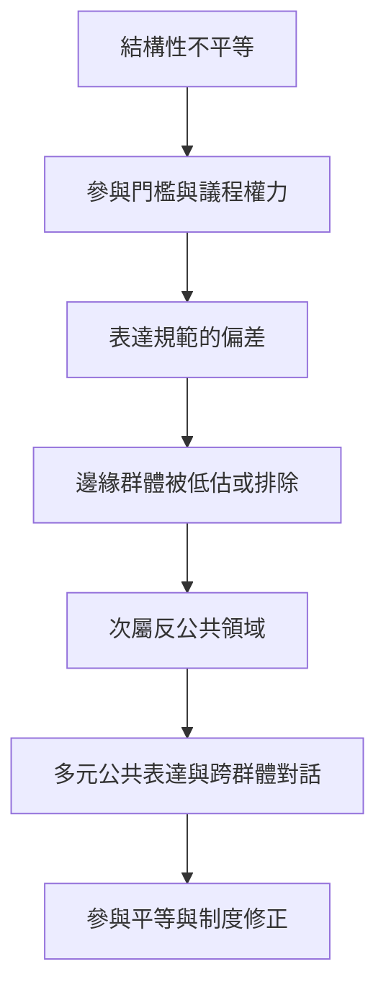

審議的包容性不等於每個人都被邀請，也不等於人人輪流發言。真正的包容要處理誰的經驗能定義問題、誰的表達被承認、誰能進入正式論壇，以及制度如何補償不平等。此地圖連結 [[包容性溝通]]、[[次屬反公共領域]]、[[審議權力不平等]] 與 [[參與平等]]。

## 關係圖

## 延伸連結
* 綜合：[[理性論證不應成為唯一被承認的公共表達方式]]、[[審議需要權力分析而非只追求禮貌]]。
* 研究：[[包容性民主必須承認敘事修辭與抗議也是政治溝通]]、[[審議場合可能重製既有權力不平等]]、[[次屬反公共領域讓邊緣群體先形成自己的語言]]。
* 概念：[[包容性溝通]]、[[次屬反公共領域]]、[[審議權力不平等]]、[[參與平等]]、[[去殖民化]]。
