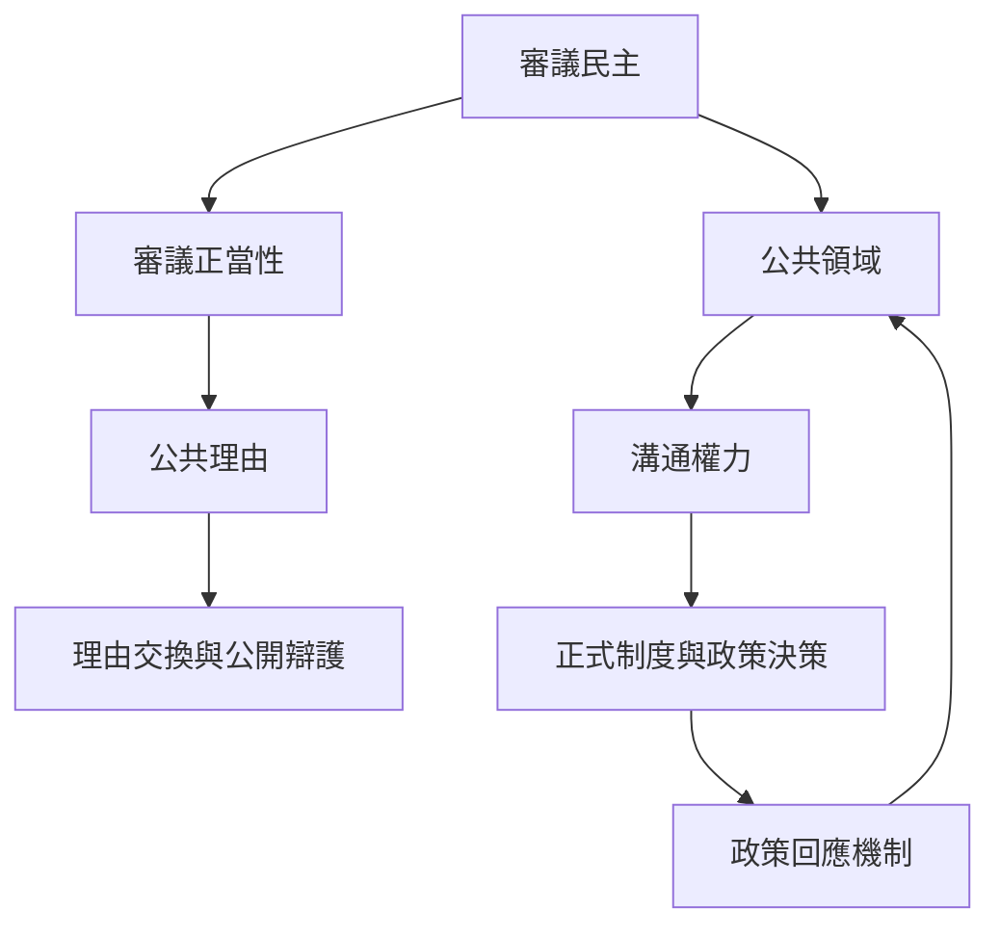

審議民主的理論問題是：在多元社會中，為什麼某個共同決定可以對所有受影響者提出正當要求？其答案不只在選票或結果，而在公民能否互相提出理由、檢驗主張、回應異議，並讓公共意見進入正式制度。此地圖串連 [[審議民主]]、[[審議正當性]]、[[公共理由]]、[[公共領域]] 與 [[溝通權力]]。

## 關係圖

## 延伸連結
* 理論：[[審議民主的核心不是投票前討論而是決策彼此可辯護]]。
* 原典：[[公共決策的正當性需要公民彼此提出可回應的理由]]、[[事實與規範說明公共溝通如何轉化為法律正當性]]。
* 概念：[[審議民主]]、[[審議正當性]]、[[公共理由]]、[[公共領域]]、[[溝通權力]]。
