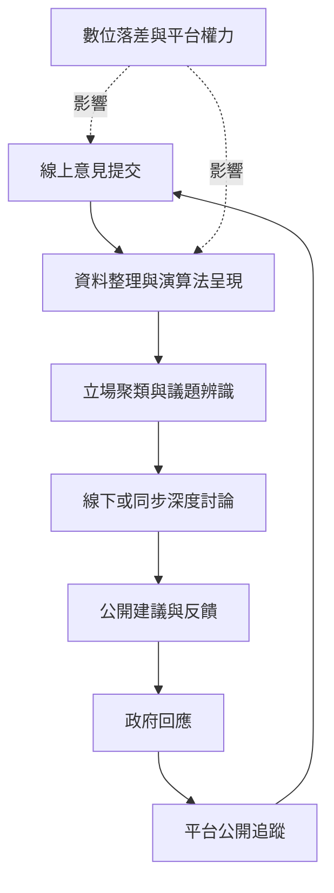

數位平台能擴大意見收集及跨地域參與，但需要與深度討論、透明治理及政策回應結合。此地圖將 [[數位審議]]、平台治理、線上意見聚類與整體 [[審議系統]] 連結起來。

## 關係圖

## 延伸連結
* 綜合：[[數位平台能擴大表達規模但不能自動形成審議]]。
* 案例：[[vTaiwan的Polis以立場聚類支援線上公共審議]]。
* 行動：[[以vTaiwan式意見聚類搭配面對面深度討論]]。
* 概念：[[數位審議]]、[[審議系統]]、[[平台治理]]、[[政策回應機制]]。
