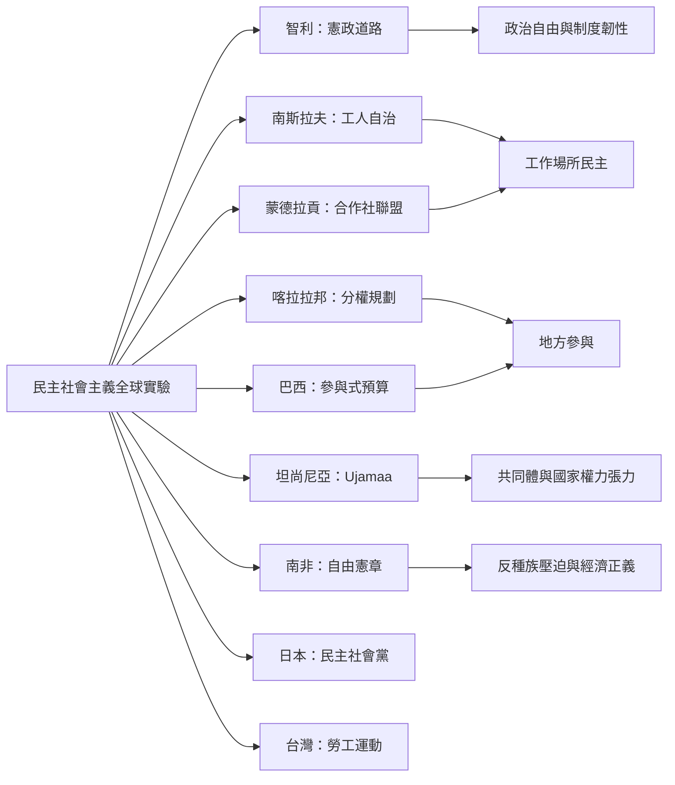

全球的民主社會主義實踐並非單一路徑：智利嘗試憲政道路，南斯拉夫發展工人自治，西班牙蒙德拉貢建立合作社網絡，印度喀拉拉邦將參與式規劃制度化，巴西阿雷格里港推動參與式預算，坦尚尼亞 Ujamaa 與南非《自由憲章》則提供反殖民、共同體與經濟正義的不同語彙。這些案例有的屬於民主社會主義實驗，有的只是可比較的制度片段，不應一概歸類。

## 關係圖

## 參考
* 案例筆記：[[智利人民團結聯盟嘗試透過憲政道路推進社會主義]]、[[南斯拉夫工人自治展示去中央集權的社會主義實驗]]、[[蒙德拉貢以合作社制度結合工人所有與企業治理]]、[[喀拉拉邦的分權規劃把公民參與帶入地方治理]]、[[巴西阿雷格里港參與式預算讓群眾介入公共支出排序]]、[[坦尚尼亞Ujamaa把非洲社會主義建立在共同體與自力更生]]、[[南非自由憲章把政治平等和經濟資源民主化連結]]。
* 比較提醒：[[社會主義的歷史評價必須同時檢視平等成就與政治自由]]。
