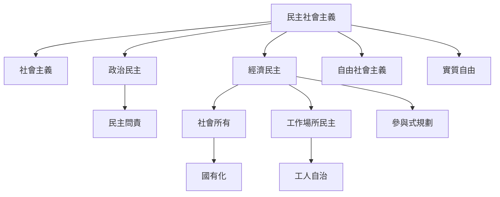

民主社會主義的核心問題，是如何讓政治民主與經濟民主互相支撐：社會成員不只透過選舉決定政府，也能共同影響生產資產、工作場所、投資與公共服務。這張地圖整理定義、價值與近鄰概念，並把「社會所有不等於國家所有」作為重要辨析。

## 關係圖

## 參考
* 概念：[[民主社會主義]]、[[社會主義]]、[[政治民主]]、[[經濟民主]]、[[社會所有]]、[[工作場所民主]]、[[工人自治]]、[[民主問責]]。
* 核心論點：[[民主社會主義的民主必須延伸至經濟權力]]、[[社會所有的關鍵不是國有化而是可問責的共同控制]]。
