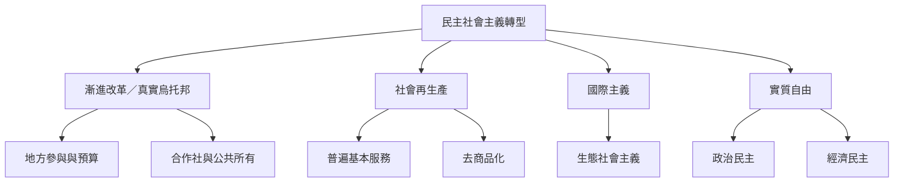

民主社會主義若只改變企業所有權，卻不處理照護、社會再生產、國際供應鏈與生態限度，仍可能延續舊有支配。轉型策略必須同時思考改革如何累積權力、公共服務如何降低市場依賴、照護工作如何重新分配，以及跨國規模的制度合作。

## 關係圖

## 參考
* 概念：[[社會再生產]]、[[普遍基本服務]]、[[去商品化]]、[[實質自由]]、[[生態社會主義]]。
* 策略：[[漸進改革只有累積權力才可能成為制度轉型]]、[[民主社會主義的制度想像應兼顧多元所有權與民主規劃]]、[[國際主義是回應跨國資本與供應鏈權力的重要尺度]]。
* 延伸行動：[[用照護時間檢驗經濟制度是否服務生命]]、[[建立跨國民主社會主義的學習網絡]]。
