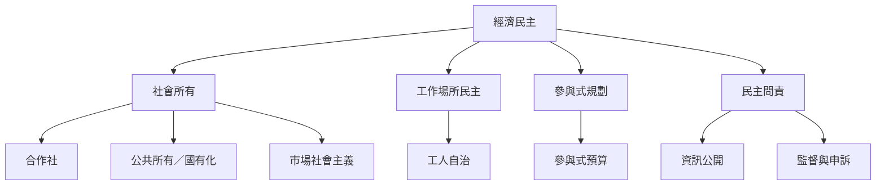

經濟民主需要制度工具把抽象的共同控制落到治理上：公共所有、合作社、工人自治、參與式規劃、參與式預算與民主問責。不同工具解決的問題不同，不能把任何單一形式當成萬用答案。對產業特性與參與者差異的辨識，是制度設計的前提。

## 關係圖

## 參考
* 概念：[[經濟民主]]、[[社會所有]]、[[合作社]]、[[國有化]]、[[市場社會主義]]、[[工人自治]]、[[工作場所民主]]、[[參與式規劃]]、[[參與式預算]]、[[民主問責]]。
* 制度分析：[[工作者自治需要資訊權與能力建設才不是形式投票]]、[[合作社能示範經濟民主卻難以獨自改變整體市場結構]]、[[公共所有可與市場並存但必須處理監督與配置機制]]。
