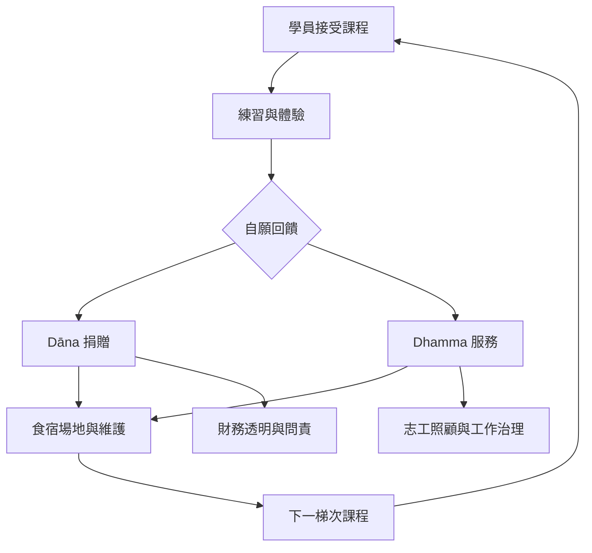

Dhamma.org 的捐款與志願服務制度，使課程得以在不收取固定學費的情況下持續運作。Dana 與 Dhamma 服務共同構成一種資源循環：學員接受課程，部分舊生回饋金錢、時間與勞動，中心再將資源用於下一梯次。這種制度的公共性需要同時由自願、透明、合理分工與服務者照顧支撐。

**概念入口**：[[term/Dāna]]、[[term/Dhamma服務]]、[[term/公共財]]、[[term/互助與共同照顧]]、[[term/舊生]]。

**文獻與分析**：[[data/課程以舊生捐款與志願服務支撐而非收取學費]]、[[data/舊生資格把個人練習與服務和長課程連結起來]]、[[note/Dana把受益者轉化為下一輪公共資源的提供者]]、[[note/志願服務既是修行實踐也是需要被看見的勞動]]。

**延伸問題**：[[idea/把Dana制度的透明度與志工照顧納入公共性評估]]、[[idea/把修習後的服務經驗連結地方互助與共同照顧]]。
