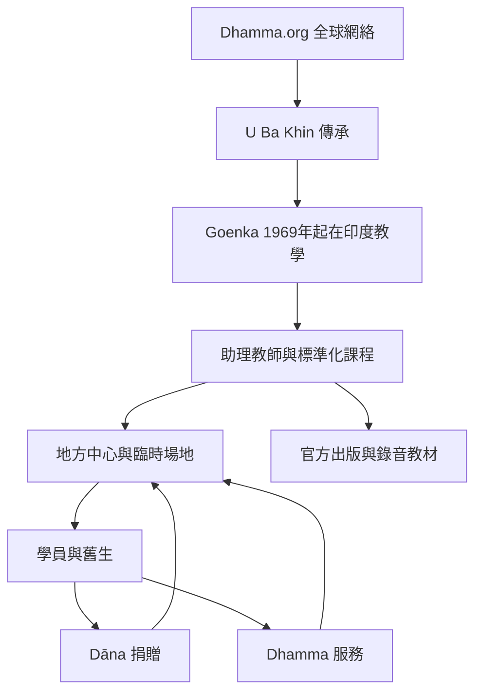

Dhamma.org 是以 Goenka 教學與 U Ba Khin 傳承為核心的跨國內觀網絡。理解它需要同時掌握傳承史、官方自我定位、出版系統、地方中心與舊生服務結構。全球網絡不是抽象理念，而是由中心、臨時場地、教師、志工與捐款循環組成。

**概念入口**：[[term/U Ba Khin傳承]]、[[term/Dhamma中心]]、[[term/舊生]]、[[term/Dhamma服務]]、[[term/Dāna]]、[[term/Vipassanā]]。

**文獻與分析**：[[data/Dhamma.org將葛印卡內觀定位為十日住院式訓練的全球網絡]]、[[data/Goenka的傳承脈絡連結緬甸在家教師與印度復興]]、[[data/Dhamma.org出版目錄提供從實修手冊到社會應用的閱讀入口]]、[[note/Dhamma.org是一個特定傳承網絡而不是所有內觀的總稱]]、[[note/傳承既提供連續性也需要歷史脈絡化]]。

**延伸問題**：[[idea/以台灣兩個中心為起點建立全球內觀服務網絡地圖]]。
