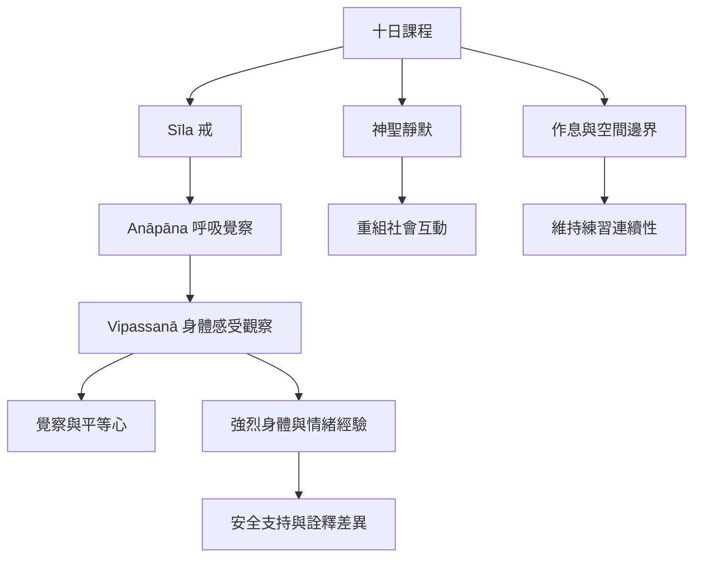

十日課程由戒律、呼吸覺察、身體感受觀察、靜默、規律作息、空間邊界與教師開示共同構成。課程設計的核心不只是增加靜坐時間，而是降低外在刺激並維持注意力連續性。這種密集制度能創造特定學習條件，也可能增加負荷，因此需把教學機制與參與者差異一起分析。

**概念入口**：[[term/Anāpāna]]、[[term/Sīla]]、[[term/Samādhi]]、[[term/Paññā]]、[[term/戒定慧]]、[[term/受（vedanā）]]、[[term/平等心]]、[[term/覺察]]、[[term/神聖靜默]]、[[term/內感受]]。

**文獻與分析**：[[data/十日課程以戒律靜默作息與邊界維持密集練習]]、[[data/瑞典訪談研究顯示強烈身體經驗可能被不同框架詮釋]]、[[data/Dhamma.org明確提醒密集課程不能取代精神醫療]]、[[note/十日課程是一套以時間空間與注意力管理構成的密集訓練]]、[[note/沉默會重組社會互動而非讓社會性消失]]、[[note/身體感受的強度與其詮釋應分開研究]]。

**延伸問題**：[[idea/為密集退修建立課前課後的支持與風險辨識流程]]、[[idea/建立平等心的多方法測量而不把它縮減成單一分數]]。
