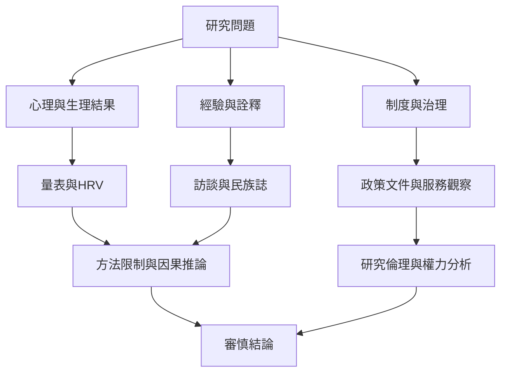

Dhamma.org 的研究材料橫跨官方方案報告、心理生理前後測、訪談、民族誌與概念評論。不同方法回答不同問題：前後測可描述短期變化，民族誌可理解經驗如何被詮釋，量表評論可檢查構念是否被正確操作化。任何單一方法都不足以完整說明課程的所有影響。

**概念入口**：[[term/心率變異度]]、[[term/因果推論]]、[[term/研究證據層級]]、[[term/研究倫理]]、[[term/密集禪修的不良經驗]]、[[term/監所內觀課程]]。

**文獻與分析**：[[data/澳洲十日課程研究觀察到心理福祉改善但樣本僅36人]]、[[data/Tihar監獄1994年研究呈現初步正向變化與重要方法限制]]、[[data/覺察與平等心的現有量表未必能完整捕捉葛印卡傳統的操作定義]]、[[data/Dhamma.org明確提醒密集課程不能取代精神醫療]]、[[note/十日課程的前後測不能單獨證明課程造成所有變化]]、[[note/監獄內觀研究支持後續研究但不足以直接證明因果]]。

**延伸問題**：[[idea/建立平等心的多方法測量而不把它縮減成單一分數]]、[[idea/為密集退修建立課前課後的支持與風險辨識流程]]、[[idea/以監獄課程研究檢視修行如何與制度性權力相遇]]。
