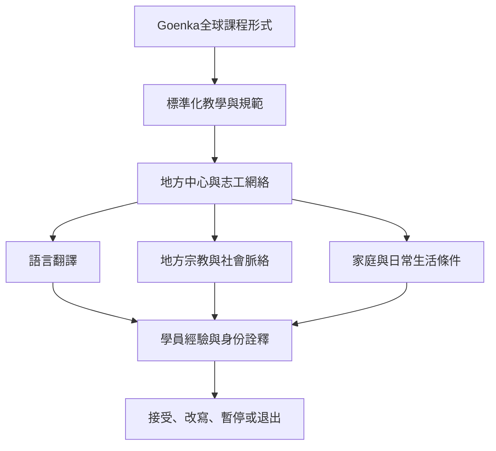

Goenka 傳承依靠教學材料與課程規範維持跨地區辨識度，但地方中心仍會受到語言、宗教背景、社會制度與生活條件影響。跨文化比較需要把全球制度與地方經驗放在同一分析框架中，而不是假設課程形式一致就代表經驗一致。

**概念入口**：[[term/非宗派論述]]、[[term/佛教現代主義]]、[[term/默會轉化]]、[[term/多重現代性]]、[[term/民族誌]]、[[term/互為主體性]]。

**文獻與分析**：[[data/以色列與美國民族誌指出靜默仍會產生互為主體性]]、[[data/紐西蘭民族誌以默會轉化理解學員如何加入或退出運動]]、[[data/阿根廷2025民族誌呈現內觀如何在非亞洲社會中形成主體]]、[[data/以色列宗教世俗化研究指出內觀的非宗教語彙仍有宗教脈絡]]、[[note/全球一致的課程形式仍會被地方文化重新詮釋]]、[[note/非宗教身份不代表修行過程沒有宗教轉化]]。

**延伸問題**：[[idea/設計一份尊重隱私的跨文化十日課程經驗訪談]]、[[idea/建立一份跨語言內觀術語對照表與經驗詞彙庫]]。
